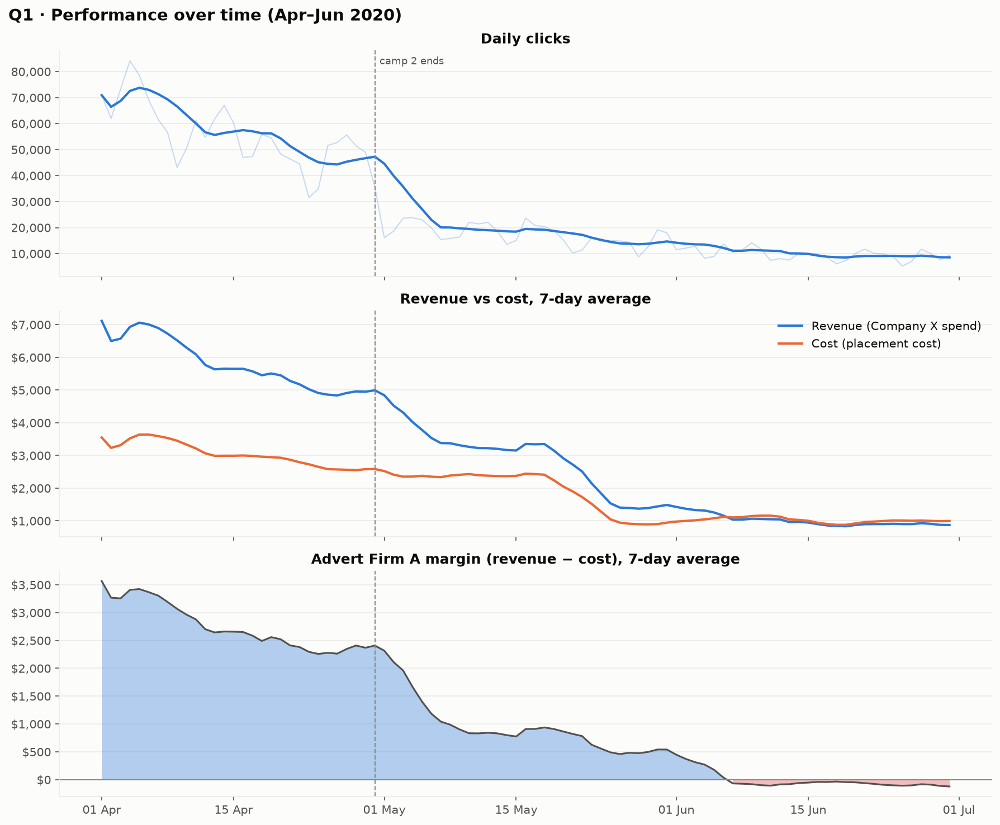
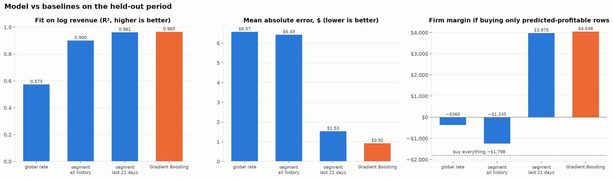

# 📊 Finlatics-Py: Online Advertising Performance Analysis

> End-to-end data science project from the **Finlatics Data Science Work Experience Program**: cleaning, exploratory analysis, a time-validated revenue model, an interactive dashboard and a REST API, all built on a real online advertising dataset.

[](https://github.com/akshat-singh05/finlatics-py/actions/workflows/tests.yml)


---

## Contents
1. [Overview](#overview)
2. [Problem statement & objectives](#problem-statement--objectives)
3. [Dataset](#dataset)
4. [Tech stack](#tech-stack)
5. [Project structure](#project-structure)
6. [Methodology](#methodology)
7. [Results](#results)
8. [Installation](#installation)
9. [How to run](#how-to-run)
10. [Dashboard](#dashboard)
11. [REST API](#rest-api)
12. [Testing](#testing)
13. [Limitations & future improvements](#limitations--future-improvements)

---

## Overview

Company X ran display-ad campaigns through an ad network, **Advert Firm A**, from April to June 2020. This project analyses those 15,408 daily records to understand what drives clicks, revenue and profitability. It then builds a model that predicts the revenue and margin of a planned ad buy *before* it runs.

| Deliverable | Where |
|---|---|
| Reproducible pipeline (load → clean → KPIs → EDA → ML) | `python main.py` |
| EDA report: 12 questions, 12 charts | [`reports/eda_findings.md`](reports/eda_findings.md) |
| Model report: method, baselines, results, SHAP | [`reports/model_report.md`](reports/model_report.md) |
| Walkthrough notebook (executed, with outputs) | [`notebooks/project_walkthrough.ipynb`](notebooks/project_walkthrough.ipynb) |
| Interactive dashboard | `streamlit run streamlit_app.py` |
| REST API | `python app.py` |

## Problem statement & objectives

**Analytical objective.** Analyse campaign performance across time, campaigns, audience engagement levels, banner sizes and publisher placements. The aim is to find trends, drivers of click-through and conversion, and where Advert Firm A makes or loses money.

**Predictive objective.** Answer: *"If Advert Firm A buys this inventory, how much revenue will it earn, and will it make a margin?"* The model uses only information available before the ads run, and is evaluated on a later time period than it was trained on.

> **Note on the brief:** the official Finlatics question list was not available. The EDA questions in [`reports/eda_findings.md`](reports/eda_findings.md) were written for this project to cover the standard brief for this dataset.

## Dataset

**File:** [`data/raw/online_advertising_performance_data.csv`](data/raw/online_advertising_performance_data.csv), the dataset used in the Finlatics program. The same data is published on Kaggle as [*Online Advertising Digital Marketing data*](https://www.kaggle.com/datasets/naniruddhan/online-advertising-digital-marketing-data). The raw file is never modified.

- 15,408 rows × 12 columns
- 1 April – 30 June 2020 (91 days)
- One row = day × campaign × engagement level × banner × placement

| Column | Meaning |
|---|---|
| `month`, `day` | Date parts (the year, 2020, comes from the dataset description) |
| `campaign_number` | `camp 1`, `camp 2`, `camp 3` (camp 2 ran in April only) |
| `user_engagement` | Audience engagement label: `Low`, `Medium`, `High` |
| `banner` | Ad size: 8 sizes from `160 x 600` to `800 x 250` |
| `placement` | Publisher space: `abc`, `def`, `ghi`, `jkl`, `mno` |
| `displays` | Ad impressions |
| `clicks` | Clicks on the ad |
| `cost` | What **Advert Firm A** paid publishers |
| `revenue` | What **Company X** paid Advert Firm A: the firm's revenue, and Company X's ad spend |
| `post_click_conversions` | Transactions attributed to the ad (post-click window) |
| `post_click_sales_amount` | Sales attributed to the ad |

**Two perspectives.** The project keeps them separate:
- **Advert Firm A:** margin = revenue − cost; ROI = margin ÷ cost
- **Company X:** ROAS = attributed sales ÷ revenue

Company X's *profit* cannot be computed because the data has no product costs.

**Data quality**

| Issue | Rows | Handling |
|---|---|---|
| Two fully empty trailing columns | — | dropped |
| Exact duplicate rows (appended at the end of the file) | 5 | removed |
| Missing `placement` | 413 | labelled `Unknown`; rows carry real cost |
| Conversions > clicks | 328 | flagged and kept (attribution window) |
| Conversions with 0 clicks | 31 | flagged and kept |
| Clicks > displays | 2 | flagged and kept |

`data/synthetic/` contains an earlier synthetic dataset (from `scripts/generate_data.py`) that was used before the original data was recovered. It is kept for reference only and is not used by the pipeline.

## Tech stack

| Tool | Purpose |
|---|---|
| Python 3.12 | Core language |
| pandas, NumPy, SciPy | Data manipulation, statistics |
| Matplotlib | Static EDA and model charts |
| scikit-learn | Pipelines, Ridge / Random Forest / Gradient Boosting, time-series CV |
| SHAP | Model explainability |
| Streamlit, Plotly | Interactive dashboard |
| Flask | REST API |
| pytest, GitHub Actions | Tests and CI |
| Docker | Reproducible environment |

## Project structure

```
finlatics-py/
├── data/
│   ├── raw/                     # original dataset (read-only)
│   ├── processed/               # cleaned + KPI table (generated, git-ignored)
│   └── synthetic/               # earlier synthetic data (reference only)
├── analysis/                    # data & EDA layer
│   ├── data_loader.py           #   load CSV, validate schema
│   ├── data_cleaning.py         #   clean, build dates, flag suspicious rows
│   ├── metrics.py               #   KPIs + ratio-of-totals aggregation
│   ├── visualizations.py        #   12 EDA charts
│   └── insights.py              #   computed findings -> reports/eda_findings.json
├── models/                      # ML layer
│   ├── feature_engineering.py   #   pre-delivery features, leakage list, time split
│   ├── trainer.py               #   pipelines + RandomizedSearchCV (time-series CV)
│   ├── evaluator.py             #   comparison, selection by CV score
│   ├── business_evaluation.py   #   baselines, $ error, profitability, margin captured
│   ├── explainability.py        #   SHAP
│   ├── ml_visualizations.py     #   residual diagnostics
│   ├── predictor.py             #   shared prediction service (API + dashboard)
│   └── saved/                   #   trained model (generated, git-ignored)
├── api/                         # Flask REST API (routes + data service)
├── reports/                     # written reports, JSON results, figures
├── notebooks/                   # executed walkthrough notebook
├── tests/                       # pytest suite (data, ML, API, dashboard)
├── utils/                       # logging, chart theme
├── scripts/generate_data.py     # synthetic data generator (reference)
├── main.py                      # pipeline entry point
├── streamlit_app.py             # dashboard
├── app.py                       # API server
├── Dockerfile
└── requirements.txt
```

## Methodology

### 1. Preprocessing
- Validate the schema and drop empty export columns.
- Normalise category text (e.g. `728X90` → `728 x 90`).
- Label missing placements `Unknown`, remove exact duplicates, and build the `date` column.
- **Flag** logically suspicious rows instead of deleting them; extreme values are real in this skewed data.
- **KPIs:**
  - CTR, CPM, conversions per click
  - Firm CPC, margin and ROI
  - Company X CPC, CPA and ROAS
  - Average order value

  All grouped rates are **ratio-of-totals** (e.g. Σclicks ÷ Σdisplays), and a zero denominator gives NaN, not 0.

### 2. Exploratory data analysis
Twelve questions cover:
- trends over time and by month (separating out the campaign mix)
- engagement segments
- banner size and placement performance
- cost-revenue and metric correlations (Pearson and Spearman)
- campaign × engagement rates and banner × placement margin
- skew and revenue concentration, weekday patterns, clicks → conversions

Skewed volumes use log scales.

### 3. Machine learning
| | |
|---|---|
| Target | `log1p(revenue)` per row; predicted margin = predicted revenue − cost |
| Features | campaign, engagement, banner, placement, weekday, day index, log(displays), log(cost): known before delivery |
| Leakage control | clicks, conversions, sales and every KPI derived from them are excluded; preprocessing runs inside the sklearn Pipeline |
| Split | **by time**: train 1 Apr – 9 Jun (12,373 rows), test 10 – 30 Jun (3,030 rows) |
| Selection | 5-fold **TimeSeriesSplit** CV + RandomizedSearchCV; the best model is chosen by CV score, never by test score |
| Models | Ridge, Random Forest, Gradient Boosting |
| Baselines | rate cards: global, per-segment (all history), per-segment (last 21 days) |
| Evaluation | R², MAE, RMSE (log), $ error, total-revenue bias, profitability precision / recall / F1 / ROC-AUC, margin captured |

## Results

### EDA highlights (full details: [`reports/eda_findings.md`](reports/eda_findings.md))

| | |
|---|---|
| Company X spend (`revenue`) | **$276,263**; placement cost $175,192; firm margin **$101,070** (ROI 58%) |
| Steady decline | average daily revenue fell from **$6,276** (first 14 days) to **$887** (last 14 days); still −79% April → June excluding camp 2 |
| Firm margin turned negative | on **24 days**, starting 1 June; June firm ROI −8% |
| One segment carries the firm | **240×400 @ ghi** produced **72%** of all firm margin; 17 banner × placement combinations lost $4,782 |
| Best banner / placement by CTR | 240×400 (1.69%) / ghi (2.09%); placement mno has 60% of displays but only 6% ROI |
| Revenue concentration | top 1% of rows = **42%** of revenue; top 10% = **89%** |
| Cost vs revenue | Pearson r = 0.76, Spearman ρ = 0.92 (strong monotonic link; Pearson is pulled down by skew) |



### Model results (full details: [`reports/model_report.md`](reports/model_report.md))

Gradient Boosting was selected by time-series CV (R² 0.979 ± 0.006 on log revenue). Results on the held-out period (10 – 30 June):

| Approach | R² (log) | MAE ($/row) | Total pred ÷ actual | Profitable F1 | ROC-AUC | Margin captured |
|---|---|---|---|---|---|---|
| Segment rate, all history | 0.900 | 6.43 | 1.98 | 0.691 | 0.795 | −$1,245 |
| Segment rate, last 21 days | 0.961 | 1.53 | 1.18 | 0.780 | 0.901 | $3,975 |
| **Gradient Boosting** | **0.965** | **0.92** | **0.98** | **0.787** | **0.903** | **$4,048** |

Buying every row in the test period would lose **−$1,798**; perfect foresight would earn **$4,171**.

- The model cuts dollar error by **40%** compared with the best baseline and forecasts total June revenue to within **2%**.
- Following its profitable calls captures **97%** of the margin available with perfect foresight.
- For profitable/not decisions alone, a regularly refreshed rate card is nearly as good. Rate cards built on all history over-predict by about 2× because of the downward trend.
- On rows costing at least $1, which carry nearly all the money, the profitability ROC-AUC is **0.987**.
- Main drivers (SHAP): cost (57%), displays (12%), Medium engagement (8%), the time trend (7%).



## Installation

```bash
git clone https://github.com/akshat-singh05/finlatics-py.git
cd finlatics-py
python -m venv .venv
```

Activate it (`.venv\Scripts\activate` on Windows, `source .venv/bin/activate` on macOS/Linux), then:

```bash
pip install -r requirements.txt
```

Dependencies are pinned to the versions the project was verified with (Python 3.12).

## How to run

```bash
python main.py
```

This runs the full pipeline (about 20 minutes on one core; mostly hyperparameter search). It:
- prints the inspection, cleaning and KPI reports
- writes `data/processed/advertising_clean.csv`
- regenerates `reports/figures/*.png`, `reports/eda_findings.json` and `reports/model_evaluation.json`
- saves the model to `models/saved/revenue_model.joblib` (with a `.meta.json`)
- writes CV, SHAP and residual charts to `output/ml/`

Options:

```bash
python main.py --no-ml                    # analysis + EDA only (~15 s)
python main.py --test-start 2020-06-01    # change the held-out period
python main.py --cv-folds 3               # fewer CV folds
```

On machines with limited memory, set `N_JOBS=1` (PowerShell: `$env:N_JOBS=1`) to train with a single worker.

**Docker** (no local Python setup needed):

```bash
docker build -t finlatics-py .
docker run --rm -v "${PWD}/reports:/app/reports" -v "${PWD}/output:/app/output" -v "${PWD}/models/saved:/app/models/saved" finlatics-py
```

**Notebook:** open `notebooks/project_walkthrough.ipynb` for a guided walkthrough using the project modules. It evaluates the saved model, so run `python main.py` first.

## Dashboard

```bash
streamlit run streamlit_app.py
```

Sidebar filters (campaign, engagement, banner, placement, date range) apply to every tab:

| Tab | Contents |
|---|---|
| Overview | KPIs, revenue vs cost trend, firm margin and click trends |
| Breakdown | Revenue, CTR and firm ROI by any dimension, plus a sortable table |
| Segments | Banner × placement heatmap (margin, revenue, CTR or ROI) |
| Insights | Key computed findings |
| Model & Predict | Model vs baselines, SHAP drivers, single prediction form, batch CSV prediction with download |
| Data | Filtered rows with CSV download |

Prediction features need a trained model (`python main.py`).

## REST API

```bash
python app.py
```

The server listens on `http://127.0.0.1:5000`. Set `API_HOST=0.0.0.0` to expose it on your network.

| Method | Endpoint | Description |
|---|---|---|
| GET | `/health` | Status, plus whether the data and model are available |
| GET | `/api/info` | Dataset summary, valid filter values, model metadata, endpoint list |
| GET | `/metrics` | Overall KPIs. Filters: `campaign_number`, `user_engagement`, `banner`, `placement`, `start`, `end` |
| GET | `/metrics/<dimension>` | KPIs per `campaign_number` (`campaign`), `user_engagement` (`engagement`), `banner`, `placement`, `month`, `weekday` or `date`; same filters |
| GET | `/insights` | EDA findings (`reports/eda_findings.json`) |
| GET | `/model` | Model vs baselines evaluation plus training metadata |
| POST | `/predict` | Predicted revenue / margin / profitability for one buy or a list (max 1,000) |

**Example:**

```bash
curl "http://127.0.0.1:5000/metrics/banner?placement=ghi&start=2020-06-01"

curl -X POST http://127.0.0.1:5000/predict -H "Content-Type: application/json" \
  -d '{"date":"2020-06-20","campaign_number":"camp 1","user_engagement":"High","banner":"240 x 400","placement":"ghi","displays":30000,"cost":20.0}'
```

```json
{"predicted_revenue": 31.8043, "cost": 20.0, "predicted_margin": 11.8043, "predicted_roi": 0.5902, "profitable": true, "warnings": []}
```

**Error handling:**
- Invalid filters or inputs return **400** with the valid values.
- An unknown dimension returns **404**.
- A missing model returns **503**.
- Predictions include **warnings** for dates after the data period and for buys under $1.

## Testing

```bash
pytest
```

The suite has **41 tests** covering:
- loading and cleaning rules
- KPI maths
- leakage and the time split
- baselines and the metric implementations
- API validation, filters and predictions
- a headless dashboard run (rendering, filtering, prediction form)

Tests that need the trained model skip when it is absent. GitHub Actions runs the suite and `python main.py --no-ml` on every push.

## Limitations & future improvements

**Limitations**
- **Short history:** three months of data from one advertiser; the test window is three weeks.
- **Attribution, not causation:** conversions and sales are attributed within a post-click window. ROAS overstates the ads' incremental effect, and camp 1's conversion rate (45 per 100 clicks vs about 2 for the others) suggests different attribution rules.
- **No product costs**, so Company X's profitability is unknown.
- **Tree models cannot extrapolate the time trend**, so the model needs regular retraining.
- **Cost/displays assumption:** the model assumes both are known when inventory is bought.

**Future improvements**
- Retrain automatically on a rolling window and monitor prediction error over time.
- Use quantile or interval predictions to show uncertainty for each planned buy.
- Optimise budget allocation across banner × placement segments under spend constraints.
- Confirm attribution rules and campaign-level conversion definitions with the data owner.
- Add more history (seasonality) and external signals (bids, creative changes).

---

## License

MIT — see [LICENSE](LICENSE).

<p align="center">Made by <a href="https://github.com/akshat-singh05">Akshat Singh</a> · Finlatics Data Science Work Experience Program</p>
