# Online Advertising Performance — EDA Findings

**Dataset:** `data/raw/online_advertising_performance_data.csv` — 15,408 rows (15,403 after removing 5 exact duplicates), 1 April – 30 June 2020, Company X's display campaigns run through Advert Firm A.
**Generated by:** `python main.py` → figures in [`reports/figures/`](figures/), numbers in [`reports/eda_findings.json`](eda_findings.json).

> **About the questions.** The official Finlatics question list was not available. The 12 questions below were written for this project to cover the standard brief for this dataset: trends, banner and placement performance, campaign and audience comparison, the cost-revenue relationship, and data quality. Every number here comes from the pipeline output.

---

## How to read the money columns

The dataset involves two businesses, and mixing them up leads to wrong conclusions:

| Column | Advert Firm A | Company X |
|---|---|---|
| `cost` | what the firm pays publishers | — |
| `revenue` | what the firm earns | **what Company X spends on ads** |
| `post_click_sales_amount` | — | sales attributed to the ads |

- **Firm ROI** = (revenue − cost) ÷ cost
- **Company X ROAS** = attributed sales ÷ revenue

Company X's *profit* ROI cannot be computed because product costs are not in the data. All grouped rates are ratio-of-totals; for example, CTR = Σclicks ÷ Σdisplays.

## Headline numbers

| Metric | Value |
|---|---|
| Displays / clicks | 239.0 M / 2.49 M (CTR **1.04%**) |
| Company X spend (`revenue`) | **$276,263** |
| Placement cost | $175,192 |
| Advert Firm A margin | **$101,070** (firm ROI **58%**) |
| Attributed conversions / sales | 651,762 / $32.7 M (ROAS 118×, average order $50.20) |

---

## Q1 · How did performance evolve over the campaign period?

- **Volume fell steadily throughout the quarter.** Average daily clicks dropped from **63,890** in the first 14 days to **8,827** in the last 14 days. Average daily revenue fell from **$6,276** to **$887** (−86%).
- **Revenue fell faster than cost, so the firm's margin was squeezed to zero.** The 7-day margin went negative in early June. **24 days had a negative firm margin**, the first on **1 June**.
- There is a sharp step down in early May, right after camp 2 ended on 30 April.

## Q2 · How do the months compare, and how much of that is campaign mix?
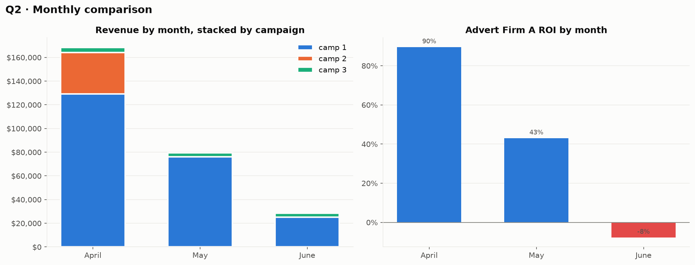

| Month | Revenue | Cost | Firm margin | Firm ROI | CTR |
|---|---|---|---|---|---|
| April | $168,343 | $88,816 | $79,527 | 90% | 1.29% |
| May | $79,489 | $55,581 | $23,907 | 43% | 0.82% |
| June | $28,431 | $30,795 | **−$2,364** | **−8%** | 0.66% |

- camp 2 contributed to April only.
- **Excluding camp 2, revenue still fell 79% from April to June**, so the decline is not just a change in campaign mix.

## Q3 · How did each user-engagement segment trend?
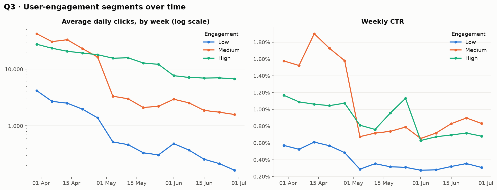

- All three segments declined.
- **Medium** engagement had the highest CTR in April (about 1.5–1.9%). It collapsed in early May, which matches camp 2's exit, since camp 2 targeted mostly Medium users.
- **High** engagement declined more gradually and became the dominant source of clicks.
- **Low** engagement consistently has the lowest CTR (about 0.3–0.6%).

> These are audience *labels* attached to each row. They do not measure any individual user's change in engagement.

## Q4 · How does banner size affect clicks and click-through?
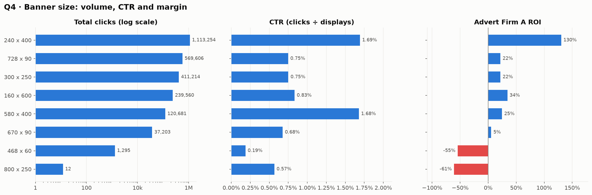

- **240×400 leads on volume, CTR and margin:**
  - 1.11 M clicks
  - CTR **1.69%**
  - 47% of revenue
  - $73,515 firm margin (ROI **130%**)
- **580×400 has a near-identical CTR (1.68%)** but about a tenth of the displays. It is a candidate for more inventory.
- **728×90 has the most displays (76.2 M)** but a CTR of only 0.75% and a firm ROI of 22%.
- **468×60 (CTR 0.19%) and 800×250 lose money** for the firm. Both are negligible in volume.

## Q5 · Which placements yield the most displays, clicks and margin?
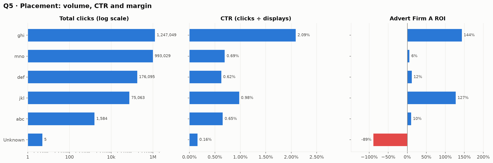

- **mno** delivers the most displays (**143.2 M**, 60% of the total) but only a 0.69% CTR and a **6% firm ROI**. It is high-volume, low-margin inventory.
- **ghi** delivers the most clicks (**1.25 M**) with the highest CTR (**2.09%**) and ROI (**144%**). It carries 55% of revenue and $89,330 of margin.
- **jkl** is small but efficient (ROI 127%).
- **def** and **abc** are marginal.
- The 413 rows with a missing placement (`Unknown`) are negligible: 5 clicks in total.

## Q6 · Is there a relationship between cost and revenue?
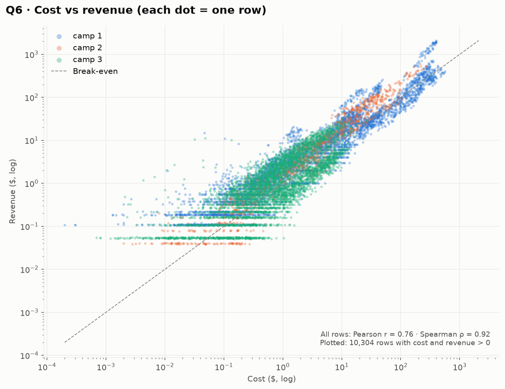

- **Yes, a strong positive relationship:**
  - Pearson **r = 0.76**
  - Spearman **ρ = 0.92**
- The gap between the two coefficients comes from heavy skew. A handful of very large rows dominate Pearson, while the rank-based measure shows a consistently monotonic link across the whole range.
- Points cluster around the break-even line, so the firm's margin per row is thin and varies a lot.
- The horizontal bands at low revenue sit at multiples of about **$0.054**, the price of one click. They come from rows with 1–4 clicks, which suggests that `revenue` is billed per click.

## Q7 · How are the metrics related to each other?
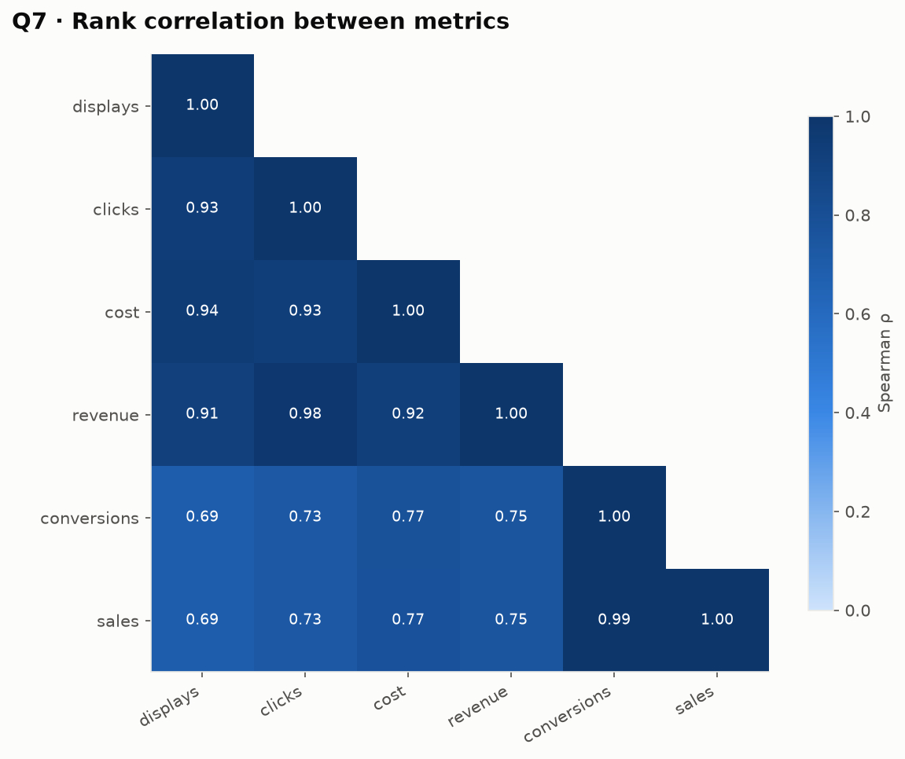

- Displays, clicks, cost and revenue all move together (Spearman 0.91–0.98). **Clicks ↔ revenue is the tightest (0.98)**, consistent with click-based pricing.
- **Conversions ↔ sales ≈ 0.99.** They are essentially the same signal, so only one should be used as a model input.
- The link from traffic to conversions is weaker (0.69–0.77). Clicks alone do not determine outcomes.

## Q8 · How do campaigns and engagement segments compare?
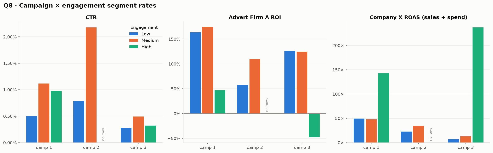

| Campaign | Active | Revenue share | CTR | Conv./click | Firm ROI | ROAS |
|---|---|---|---|---|---|---|
| camp 1 | Apr 1 – Jun 30 | **83%** | 0.98% | 44.9% | 53% | 135× |
| camp 2 | **Apr 1 – Apr 30** | 13% | **1.94%** | 1.6% | **105%** | 33× |
| camp 3 | Apr 1 – Jun 30 | 4% | 0.40% | 2.4% | 45% | 49× |

- **camp 2 had the best CTR and firm ROI but ran for one month only.** Compare it on rates, not totals.
- **High engagement** produces 77% of revenue and the highest ROAS (144×), but the lowest firm ROI (45%).
- **Medium** engagement is the firm's most profitable audience (ROI **129%**).
- **camp 3 × High is the only campaign-segment that loses money for the firm (ROI −47%).** It also shows the highest ROAS (237×).
- camp 2 has no High-engagement rows.

## Q9 · Which banner × placement combinations make or lose money?
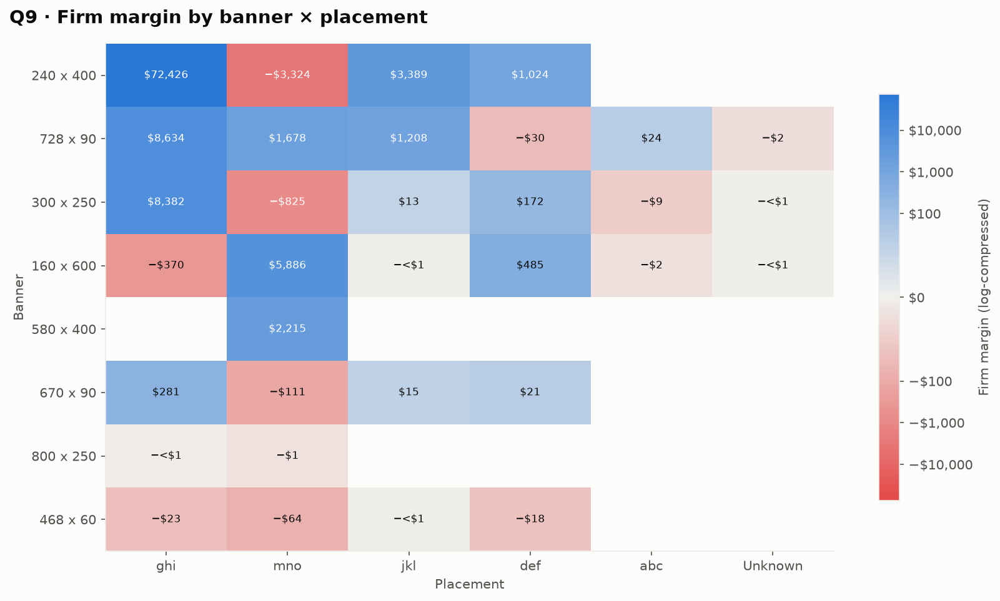

- **240×400 @ ghi alone produced $72,426, or 72% of all firm margin** (ROI 230%).
- The next best combinations are all far smaller:
  - 728×90 @ ghi: $8,634
  - 300×250 @ ghi: $8,382
  - 160×600 @ mno: $5,886
- **17 combinations lost money, $4,782 in total.** The largest losses are:
  - **240×400 @ mno: −$3,324**. The best banner loses money on mno.
  - 300×250 @ mno: −$825
  - 160×600 @ ghi: −$370
- The same banner performs very differently across placements. **Placement, not creative size alone, drives profitability.**

## Q10 · How skewed are the metrics, and how concentrated is revenue?
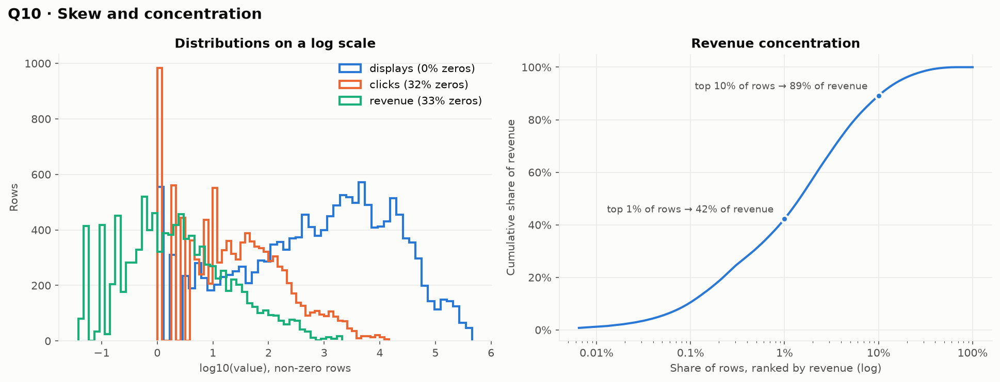

- **The data is extremely right-skewed.** Skewness: displays 5.1, cost 6.1, clicks 10.0, revenue 12.8.
- **It is zero-inflated:**
  - 32% of rows have no clicks
  - 33% have no revenue
  - 64% have no conversions
- **Revenue is highly concentrated: the top 1% of rows produce 42% of revenue, and the top 10% produce 89%.**
- 53% of rows have a negative firm margin. Most are tiny rows where a small placement cost earns nothing.
- **Implication:** use medians, log scales and ratio-of-totals. Plain averages and Pearson correlations are misleading here.

## Q11 · Is there a day-of-week pattern?
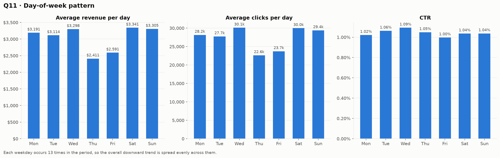

- Using per-day averages (each weekday occurs 13 times), **Thursday ($2,411/day) and Friday ($2,591/day) are weaker**.
- Saturday is the strongest day at $3,341/day, a ratio of about 1.39× to Thursday.
- CTR is flat across weekdays (1.00–1.09%). **The difference is in volume, not engagement quality.**
- With only 13 observations per weekday and a strong downward trend, treat this as a hypothesis to test, not a conclusion.

## Q12 · Do clicks translate into conversions?
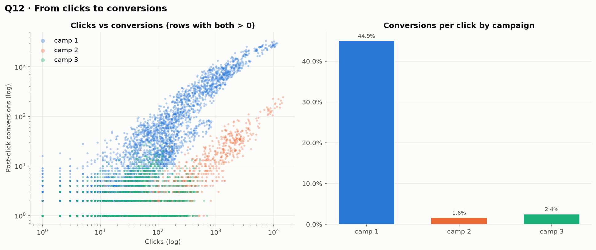

- **The conversion rate differs by an order of magnitude between campaigns:**
  - camp 1: 44.9 conversions per 100 clicks
  - camp 2: 1.6
  - camp 3: 2.4
- Within each campaign, conversions rise with clicks, but camp 1 sits on a far higher line.
- The size of the gap suggests that camp 1's conversions (which drive most ROAS and sales) may be counted under a different attribution rule or funnel. **Confirm this with the data owner before comparing campaigns on ROAS.**

---

## Data-quality notes

| Issue | Rows | Handling |
|---|---|---|
| Fully empty trailing columns | 2 columns | dropped |
| Exact duplicate rows (all appended at the end of the file) | 5 | removed; no conflicting duplicates on the row grain remain |
| Missing `placement` | 413 | labelled `Unknown` (rows carry real cost) |
| Conversions > clicks | 328 | kept and flagged (post-click attribution window) |
| Conversions with 0 clicks | 31 | kept and flagged |
| Clicks > displays | 2 | kept and flagged |
| Year not in the file | — | assumed 2020 per the dataset description |

## Recommendations (for Advert Firm A)

1. **Protect and grow the core: 240×400 @ ghi.** It produces 72% of margin. Check whether more ghi inventory exists for 240×400, 300×250 and 728×90.
2. **Reprice or reduce mno.** It is 60% of displays at a 6% ROI, and it is where the largest losses sit (240×400 @ mno, 300×250 @ mno).
3. **Investigate the June turn to losses.** Revenue fell faster than cost from May onward. Review bid and price levels before running similar campaigns.
4. **Review camp 3 × High engagement.** It is the only campaign-segment with a negative firm ROI.
5. **Drop or retest 468×60 and 800×250.** They have the lowest CTR and lose money.

## Limitations

- **Three months, one advertiser.** Seasonality and longer trends cannot be separated from the campaign lifecycle.
- **Attribution.** Conversions and sales are attributed within a post-click window, not proven to be caused by the ads, so ROAS overstates incremental impact.
- **No product costs**, so Company X's profitability is unknown.
- **The causes of the decline are not in the data.** Budget, bids, creative fatigue and market conditions are not recorded.
