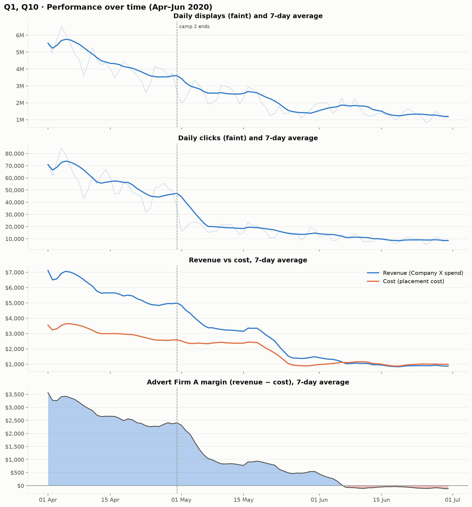
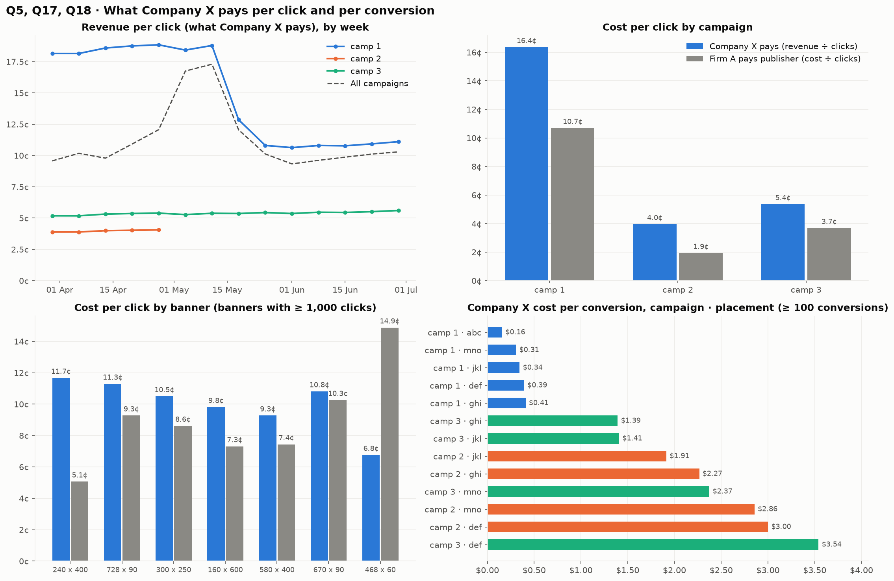
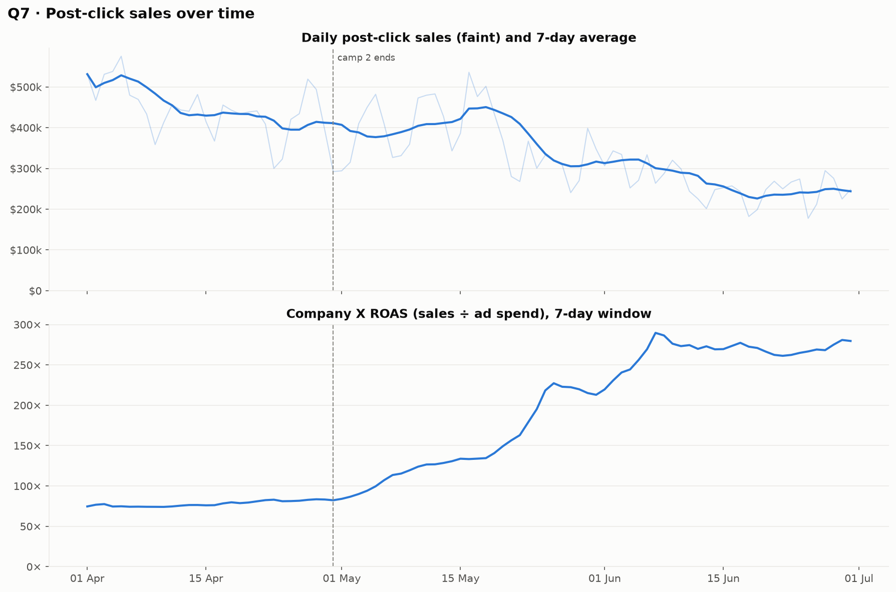
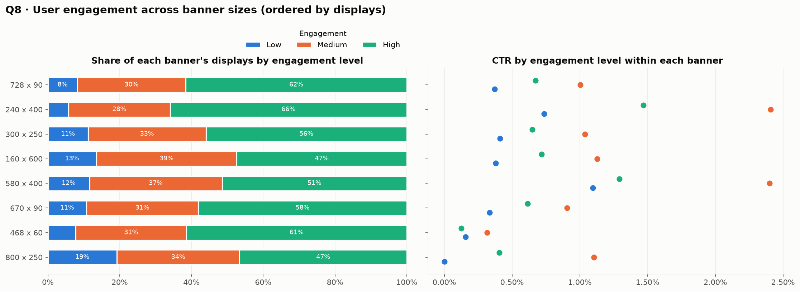
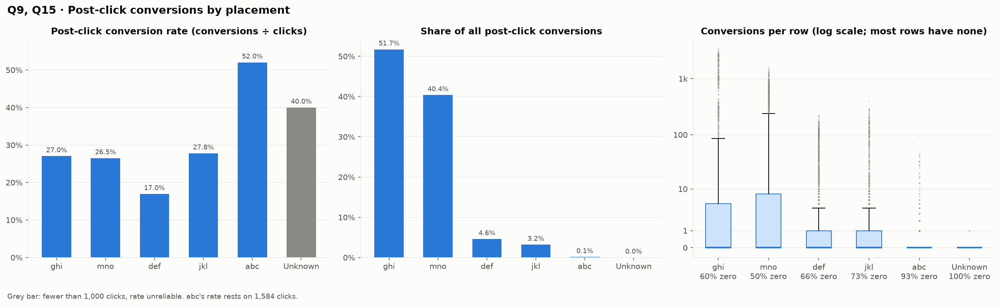
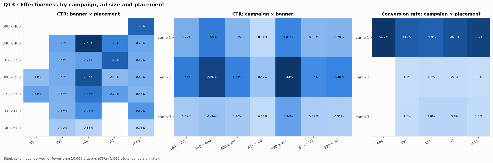
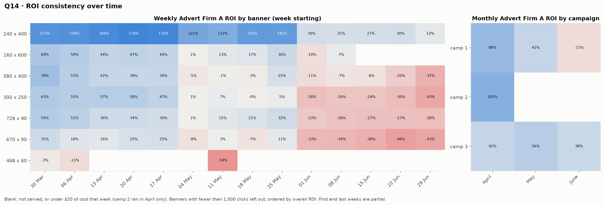
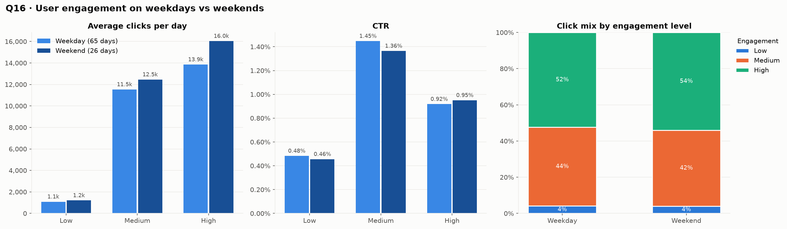

# Online Advertising Performance — EDA Findings

**Dataset:** `data/raw/online_advertising_performance_data.csv`: 15,408 rows, or 15,403 after removing 5 exact duplicates. It covers 1 April – 30 June 2020, Company X's display campaigns served through Advert Firm A.
**Questions:** the 20 questions in the Finlatics problem statement, answered in order as Q1–Q20.
**Generated by:** `python main.py`. Figures are in [`reports/figures/`](figures/) and every number is in [`reports/eda_findings.json`](eda_findings.json).

---

## How to read the money columns

The problem statement defines `revenue` as *the price Company X pays Advert Firm A for the clicks* and `cost` as *the price Advert Firm A pays the publisher*. Two businesses are involved, so each money column means something different to each:

| Column | Advert Firm A | Company X |
|---|---|---|
| `cost` | what the firm pays publishers | — |
| `revenue` | what the firm earns | **what Company X spends on ads** |
| `post_click_sales_amount` | — | sales attributed to the ads (30-day post-click window) |

The two return measures are:
- **Firm ROI** = (revenue − cost) ÷ cost. This is the "ROI" used throughout.
- **Company X ROAS** = attributed sales ÷ revenue.

Company X's *profit* ROI cannot be computed, because product costs are not in the data.

All grouped rates are ratio-of-totals: for example, CTR = Σclicks ÷ Σdisplays, and conversion rate = Σconversions ÷ Σclicks.

## Headline numbers

| Metric | Value |
|---|---|
| Displays / clicks | 239.0 M / 2.49 M (CTR **1.04%**) |
| Company X spend (`revenue`) | **$276,263** (**$0.111 per click**) |
| Placement cost | $175,192 |
| Advert Firm A margin | **$101,070** (firm ROI **58%**) |
| Post-click conversions / sales | 651,762 / $32.7 M (ROAS 118×, average order $50.20) |

---

## Q1 · What is the overall trend in user engagement throughout the campaign period?

- **Engagement fell steadily all quarter.**
  - Average daily clicks dropped from **63,890** in the first 14 days to **8,827** in the last 14 days.
  - CTR fell from **1.28%** to **0.70%**, so users clicked less often, not just less ad volume.
- **All three engagement levels declined:**
  - **Medium** had the highest CTR in April (about 1.5–1.9%). It collapsed in early May, which matches the end of camp 2, a campaign that targeted Medium users almost entirely.
  - **High** declined more gradually and became the main source of clicks.
  - **Low** always had the lowest CTR (about 0.3–0.6%).
- There is a sharp step down in early May, right after camp 2 ended on 30 April. Even without camp 2, revenue fell **79%** from April to June (see the appendix).

> Engagement levels are audience *labels* attached to each row. They do not measure how any individual user's engagement changed.

## Q2 · How does the size of the ad (banner) impact the number of clicks generated?

- **240×400 generates the most clicks: 1.11 M, or 45% of all clicks.** It also has the highest CTR (**1.69%**).
- **728×90 has the most displays (76.2 M)** but converts them to clicks at only 0.75%, so it ranks second on clicks (570k).
- **580×400 matches 240×400 on CTR (1.68%)** with about a tenth of the displays, so it is a candidate for more inventory.
- 300×250 (0.75%), 160×600 (0.83%) and 670×90 (0.68%) sit in the middle.
- **468×60 (CTR 0.19%) and 800×250 (12 clicks in total) barely generate clicks.**
- **Takeaway:** size matters, but not simply "bigger is better". The two 400-pixel-tall formats lead on CTR, and wide leaderboard formats (728×90, 468×60) trail.

## Q3 · Which publisher spaces (placements) yielded the highest number of displays and clicks?

| Placement | Displays | Clicks | CTR |
|---|---|---|---|
| **mno** | **143.2 M** (60%) | 993k | 0.69% |
| **ghi** | 59.7 M | **1.25 M** (50%) | **2.09%** |
| def | 28.2 M | 176k | 0.62% |
| jkl | 7.7 M | 75k | 0.98% |
| abc | 0.24 M | 1.6k | 0.65% |
| Unknown | 3.2k | 5 | — |

- **mno leads on displays, ghi leads on clicks.** ghi gets more clicks from less than half of mno's displays.
- The 413 rows with a missing placement (`Unknown`) are negligible.

## Q4 · Is there a correlation between the cost of serving ads and the revenue generated from clicks?

- **Yes, a strong positive one:**
  - Pearson **r = 0.76**
  - Spearman **ρ = 0.92**
- The gap between the two comes from heavy skew. A handful of very large rows dominate Pearson, while the rank-based measure shows a consistently monotonic link across the whole range.
- **Clicks ↔ revenue is the tightest pair (ρ = 0.98)**, consistent with click-based pricing (see Q5).
- Points cluster around the break-even line, so the firm's margin per row is thin and varies a lot.

## Q5 · What is the average revenue generated per click for Company X during the campaign period?

- **$0.111 per click overall** ($276,263 ÷ 2.49 M clicks). This is what Company X paid Advert Firm A per click.
- By month: April **$0.101**, May **$0.147**, June **$0.097**.
- **The price per click is set by campaign:**
  - camp 2: **$0.040**, flat
  - camp 3: **$0.054**, flat
  - camp 1: about **$0.18–0.19** until mid-May, then about **$0.11**
- The May peak therefore comes from campaign mix (cheap camp 2 ended) plus camp 1's higher early price.
- Sales attributed per click were **$13.12**. This is the measure to use if "revenue" means Company X's own sales.

## Q6 · Which campaigns had the highest post-click conversion rates?

| Campaign | Active | Clicks | Conversions | Conversion rate |
|---|---|---|---|---|
| **camp 1** | Apr 1 – Jun 30 | 1.41 M | 633,082 | **44.9%** |
| camp 3 | Apr 1 – Jun 30 | 203k | 4,913 | 2.4% |
| camp 2 | Apr 1 – Apr 30 | 881k | 13,767 | 1.6% |

- **camp 1 converts about 20–30× better than the others.**
- The gap is so large that camp 1's conversions may be counted under a different attribution rule or funnel. **Confirm this with the data owner before comparing campaigns on conversions or ROAS.**

## Q7 · Are there any specific trends or patterns in post-click sales amounts over time?

| Month | Post-click sales | ROAS |
|---|---|---|
| April | $13.2 M | 78× |
| May | $11.7 M | 147× |
| June | $7.8 M | 274× |

- **Sales fell, but much more slowly than ad spend.**
  - Average daily sales dropped **49%**, from $473k in the first 14 days to $240k in the last 14.
  - Over the same windows, revenue (ad spend) fell **86%**.
- As a result, **Company X's ROAS rose from about 75× to about 280×.** Each ad dollar was credited with more sales as spend fell.
- **camp 1 produces 95% of all sales.** Its monthly sales were $11.8 M, $11.6 M and $7.7 M.
- The highest sales days were early-April weekends (4–5 April, about $0.54–0.58 M) and 16 May.

## Q8 · How does the level of user engagement vary across different banner sizes?

- **High engagement is the largest share of displays on every banner size.**
  - **240×400 is the most High-skewed** (66% High, 28% Medium, 6% Low).
  - 160×600 and 800×250 are the least High-skewed (about 47% High).
- **CTR ranks Medium > High > Low on all 8 banner sizes.** Medium users click at least twice as often as Low users on the same creative.
- On 240×400, for example, CTR is 2.41% for Medium, 1.47% for High and 0.74% for Low.

## Q9 · Which placement types result in the highest post-click conversion rates?

| Placement | Clicks | Conversion rate |
|---|---|---|
| abc | 1,584 | **52.0%** (small sample) |
| **jkl** | 75k | **27.8%** |
| ghi | 1.25 M | 27.0% |
| mno | 993k | 26.5% |
| def | 176k | 17.0% |

- Among placements with meaningful volume, **jkl, ghi and mno convert almost equally (26.5–27.8%)**. **def is clearly weakest (17.0%).**
- abc's 52% rests on only 1,584 clicks, so treat it as a lead to test, not a result.

## Q10 · Can we identify any seasonal patterns or fluctuations in displays and clicks throughout the campaign period?

- **The dominant pattern is a steady decline, not seasonality.**
  - Displays averaged **5.0 M a day** in the first 14 days and **1.26 M** in the last 14 (peak: 6.5 M on 4 April).
  - Clicks fell from **63,890** to **8,827** a day.
- **There are two step changes:**
  - early May, when camp 2 ended
  - late May, when clicks and revenue dropped again
- **There is a weekly rhythm in volume:**
  - **Thursday (2.16 M displays, 22.6k clicks per day) and Friday are the quietest days.**
  - Saturday is the busiest (2.89 M displays, 30.0k clicks).
  - CTR barely moves across weekdays (1.00–1.09%), so the difference is in volume, not click quality.
- Three months of data cannot separate true seasonality from the campaign lifecycle. With 13 occurrences of each weekday, treat the weekly rhythm as a hypothesis.

## Q11 · Is there a correlation between user engagement levels and the revenue generated?

| Engagement | Revenue share | Revenue per 1,000 displays | Revenue per click |
|---|---|---|---|
| Low | 1.9% | $0.24 | $0.050 |
| Medium | 21.3% | $0.78 | $0.055 |
| High | **76.8%** | **$1.50** | **$0.161** |

- **Yes, at the segment level. Revenue per display rises steadily with engagement: Low $0.24, Medium $0.78, High $1.50 per 1,000 displays.**
- Row by row, the rank correlation is weak (Spearman **0.20**), because each level contains rows of every size.
- Much of High's lead comes from **campaign mix**. Most High rows belong to camp 1, which charges about $0.16 per click, while Low and Medium rows are spread across the cheaper camp 2 and camp 3.
- **Within a campaign, Medium earns the most per display** (camp 1: $1.78 Medium vs $1.60 High).

## Q12 · Are there any outliers in terms of cost, clicks, or revenue that warrant further investigation?

- **On the raw scale, about 16% of rows are "outliers" (1.5 × IQR).** That says more about the extreme skew than about bad data:
  - Skewness: cost 6.1, clicks 10.0, revenue 12.8.
  - 32% of rows have no clicks, and 33% have no revenue.
  - The top 1% of rows produce 42% of revenue.
- **On a log scale:**
  - **1,228 cost** rows and **943 revenue** rows are high outliers.
  - **Clicks have none.**
  - The maximums are $557 cost, 14,566 clicks and $2,096 revenue in a single row.
- **The largest rows look genuine.** The top five revenue rows are all camp 1 · High · 240×400 · ghi on early-April days, the segment that drives the business.
- **These warrant investigation:**
  - **206 rows have clicks but $0 revenue.** If revenue is billed per click, this is unbilled traffic or a reporting gap.
  - **328 rows report more conversions than clicks**, and **31 report conversions with no clicks**. The 30-day post-click window can explain some of this, but not all.
  - **2 rows report more clicks than displays**, which is impossible as recorded.
  - The flagged rows are kept and marked in the cleaned data (see the data-quality notes).

## Q13 · How does the effectiveness of campaigns vary based on the size of the ad and placement type?

- **Placement drives effectiveness more than size.**
  - **240×400 @ ghi** has the best CTR (**2.59%**). The same banner on mno gets only 0.70%.
  - 300×250 @ ghi reaches 2.05%, more than three times its rate on any other placement.
- **The best banner differs by campaign:**
  - camp 1: 240×400 (CTR 1.56%)
  - camp 2: 580×400 (**3.33%**)
  - camp 3: 580×400 (0.96%)
  - camp 2 has the highest CTR on every banner, and camp 3 the lowest.
- **Conversion rate by campaign × placement:**
  - camp 1 converts 40–60% on every placement (best: mno 53.9%, abc 59.9%).
  - camp 2 converts 1.3–2.1%, and camp 3 1.5–3.8%.
  - In camp 2 and camp 3, jkl and ghi convert best.
- **Margin for Advert Firm A:**
  - **240×400 @ ghi alone produced $72,426, or 72% of all firm margin.**
  - **17 banner × placement combinations lost money ($4,782 in total).** The largest loss is 240×400 @ mno (−$3,324).

## Q14 · Are there any specific campaigns or banner sizes that consistently outperform others in terms of ROI?

- **Banner: 240×400 is the clear consistent leader.**
  - It had the best firm ROI in **all 14 weeks**, among banners with at least $20 of cost that week.
  - It is the **only banner profitable in every month** (166%, then 129%, then 27%).
  - Every other main banner was loss-making by June.
- **Campaign:**
  - **camp 3 is the most consistent**, with ROI between 38% and 56% every month.
  - **camp 1 started strongest but slid** from 88% to 42% to **−11%** in June.
  - camp 2 had the best ROI (105%) but ran for April only, so its consistency cannot be judged.
- From Company X's side the order flips. camp 1's ROAS **rose** from 91× to 303× as its spend fell.

## Q15 · What is the distribution of post-click conversions across different placement types?

| Placement | Share of conversions | Rows with zero conversions | Median per row | 99th percentile per row |
|---|---|---|---|---|
| **ghi** | **51.7%** | 60% | 0 | 2,396 |
| **mno** | **40.4%** | 50% | 0 | 879 |
| def | 4.6% | 66% | 0 | 130 |
| jkl | 3.2% | 73% | 0 | 180 |
| abc | 0.1% | 93% | 0 | 30 |

- **Two placements account for 92% of conversions.**
- Within every placement, the distribution is **extremely skewed**:
  - The median row has zero conversions.
  - A few large rows carry most of the total (ghi's largest row has 3,369).

## Q16 · Are there any noticeable differences in user engagement levels between weekdays and weekends?

| Engagement | Clicks/day, weekday | Clicks/day, weekend | CTR, weekday | CTR, weekend |
|---|---|---|---|---|
| Low | 1,087 | 1,204 (+11%) | 0.48% | 0.46% |
| Medium | 11,534 | 12,455 (+8%) | 1.45% | 1.36% |
| High | 13,853 | 16,036 (**+16%**) | 0.92% | 0.95% |

- **Weekends carry more volume at every engagement level**: 12–18% more displays and 8–16% more clicks per day.
- **CTR barely changes.** The engagement mix shifts only slightly toward High at weekends (54% of clicks vs 52% on weekdays).
- Weekend gains come from more ads served, not more engaged users. There are 26 weekend days and 65 weekdays in the period.

## Q17 · How does the cost per click (CPC) vary across different campaigns and banner sizes?

The data supports two CPCs:
- **Company X's CPC** = revenue ÷ clicks
- **Advert Firm A's CPC** = cost ÷ clicks

| Campaign | Company X CPC | Firm A CPC |
|---|---|---|
| camp 1 | **$0.164** | $0.107 |
| camp 2 | $0.040 | $0.019 |
| camp 3 | $0.054 | $0.037 |

- **Company X's CPC is set per campaign, and is the same whatever the banner.** Within a campaign, every banner is priced about the same (camp 2 = $0.0396 on all eight).
- Banner-level averages therefore differ only through campaign mix: 240×400 at $0.117 and 728×90 at $0.113 are camp 1-heavy.
- **Firm A's CPC varies a lot by banner:**
  - **240×400 is the cheapest to deliver ($0.051 per click)**, which is why it is so profitable.
  - 468×60 costs $0.149 per click, more than twice what Company X pays for it ($0.068).
  - 670×90 costs $0.103, nearly all of the $0.108 that Company X pays.

## Q18 · Are there any campaigns or placements that are particularly cost-effective in terms of generating post-click conversions?

This uses cost per conversion for Company X (revenue ÷ conversions).

- **By campaign, camp 1 is far more cost-effective:**
  - camp 1: **$0.36**
  - camp 3: $2.21
  - camp 2: $2.53
- **By placement** (≥ 100 conversions):
  - abc: $0.17 (tiny volume)
  - **mno: $0.38**
  - **jkl: $0.40**
  - ghi: $0.45
  - def: $0.53
- **The most cost-effective large combination is camp 1 · mno at $0.31 per conversion.** The least is camp 3 · def at $3.54.
- mno's low CTR (Q3) is offset by cheap clicks and a normal conversion rate.

## Q19 · Can we identify any trends or patterns in post-click conversion rates based on the day of the week?

- **The overall conversion rate is fairly flat, from 24.8% (Wednesday) to 27.5% (Tuesday)**, with no clear weekday or weekend pattern.
- **Within camp 1 (97% of conversions), Thursday (48.5%) and Friday (47.9%) convert best.** Saturday (42.3%) and Sunday (43.5%) convert worst.
- So the quietest days for volume (Q10) convert slightly better, and the busiest weekend days slightly worse.
- With 13 occurrences of each weekday, this is a pattern to test, not a firm conclusion.

## Q20 · How does the effectiveness of campaigns vary throughout different user engagement types in terms of post-click conversions?

| Campaign · engagement | Conversions | Conversion rate | Cost per conversion | ROAS |
|---|---|---|---|---|
| camp 1 · High | 617,241 | **48.1%** | **$0.34** | 143× |
| camp 1 · Medium | 15,249 | 12.7% | $1.26 | 48× |
| camp 1 · Low | 592 | 11.7% | $1.39 | 49× |
| camp 2 · Medium | 12,923 | 1.6% | $2.51 | 34× |
| camp 2 · Low | 844 | 1.4% | $2.89 | 23× |
| camp 3 · High | 3,678 | **10.9%** | **$0.49** | **237×** |
| camp 3 · Medium | 1,085 | 0.8% | $6.58 | 13× |
| camp 3 · Low | 150 | 0.4% | $12.56 | 7× |

- **High-engagement users convert far better in every campaign that targets them:**
  - camp 1: about **4×** the rate of its Low and Medium users
  - camp 3: about **14–27×**
- **camp 2 had no High-engagement rows.** That explains its uniformly low conversion rate despite the best CTR.
- **camp 3 · High is the trade-off case.** It is Company X's best segment (ROAS 237×) but the only campaign-segment that loses money for Advert Firm A (ROI −47%).

---

## Appendix · Supporting analysis

### Monthly comparison and campaign mix

| Month | Revenue | Cost | Firm margin | Firm ROI | CTR |
|---|---|---|---|---|---|
| April | $168,343 | $88,816 | $79,527 | 90% | 1.29% |
| May | $79,489 | $55,581 | $23,907 | 43% | 0.82% |
| June | $28,431 | $30,795 | **−$2,364** | **−8%** | 0.66% |

- camp 2 contributed to April only.
- **Excluding camp 2, revenue still fell 79% from April to June**, so the decline is not just campaign mix.
- **24 days had a negative firm margin**, the first on **1 June**.

### Correlation between metrics (Spearman)
- Displays, clicks, cost and revenue move together (ρ 0.91–0.98).
- **Conversions ↔ sales ≈ 0.99.** They are essentially the same signal.
- The link from traffic to conversions is weaker (0.69–0.77). Clicks alone do not determine outcomes.

---

## Data-quality notes

| Issue | Rows | Handling |
|---|---|---|
| Fully empty trailing columns | 2 columns | dropped |
| Exact duplicate rows (all appended at the end of the file) | 5 | removed; no conflicting duplicates on the row grain remain |
| Missing `placement` | 413 | labelled `Unknown` (rows carry real cost) |
| Conversions > clicks | 328 | kept and flagged (post-click attribution window) |
| Conversions with 0 clicks | 31 | kept and flagged |
| Clicks > displays | 2 | kept and flagged |
| Clicks but $0 revenue | 206 | kept; listed under Q12 for investigation |
| Year not in the file | — | 2020, per the problem statement |

## Recommendations

**For Advert Firm A:**
1. **Protect and grow 240×400 @ ghi.** It produces 72% of margin and 240×400 is the only banner that stayed profitable all quarter. Check whether more ghi inventory exists.
2. **Reprice or reduce mno.** It is 60% of displays at a 6% ROI, and it holds the largest losses (240×400 @ mno, 300×250 @ mno).
3. **Fix pricing before running similar campaigns.** camp 1's price per click dropped from about $0.19 to $0.11 in mid-May while delivery costs did not, and margin turned negative in June.
4. **Review camp 3 · High.** It is the only campaign-segment with a negative firm ROI, even though it performs best for Company X.
5. **Drop or retest 468×60 and 800×250.** They have the lowest CTR and cost more to deliver than they earn.

**For Company X:**
1. **Weight budget toward High-engagement audiences.** They convert 4–27× better and cost $0.34–0.49 per conversion.
2. **mno and jkl are the cheapest placements per conversion.** Use them for conversion goals, and ghi for click goals.
3. **Investigate the 206 clicked-but-unbilled rows and camp 1's attribution rule** before relying on ROAS comparisons between campaigns.

## Limitations

- **Three months, one advertiser.** Seasonality cannot be separated from the campaign lifecycle.
- **Attribution.** Conversions and sales are attributed within a 30-day post-click window, not proven to be caused by the ads, so ROAS overstates incremental impact.
- **No product costs**, so Company X's profitability is unknown.
- **The causes of the decline are not in the data.** Budget, bids, creative fatigue and market conditions are not recorded.
- **Thin segments.** Rates for segments with fewer than 1,000 clicks (or 100 conversions for cost per conversion) are shown but not ranked.
