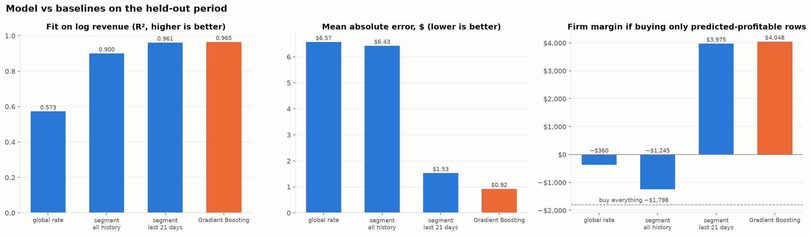
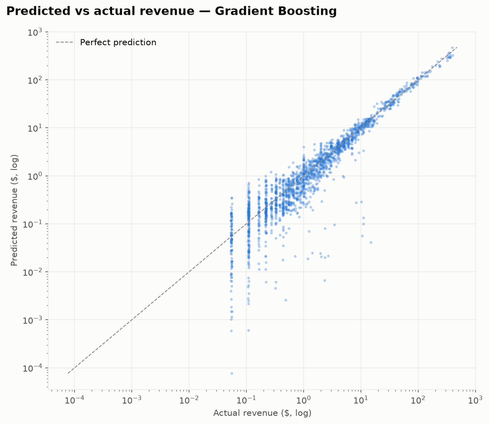
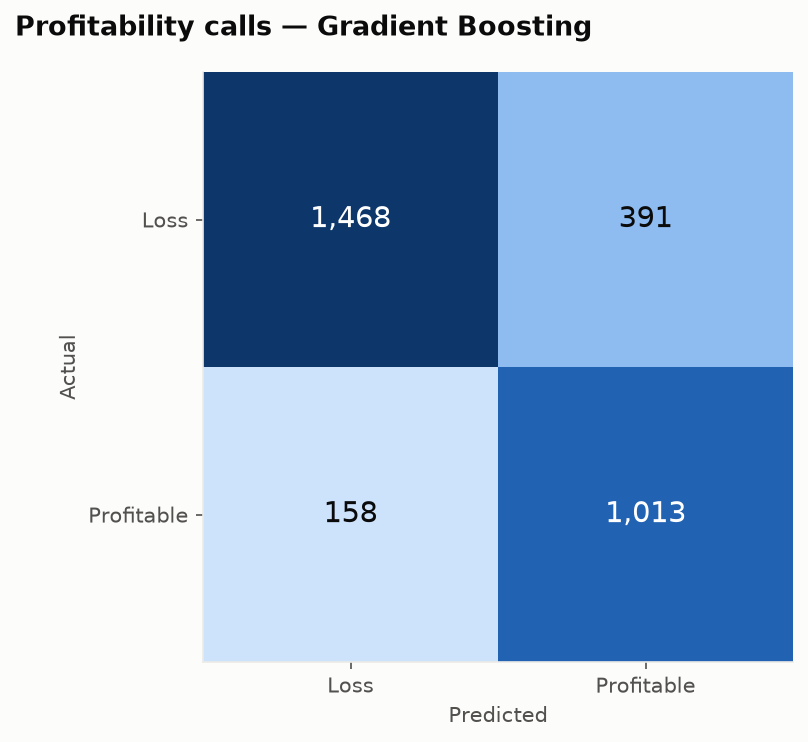

# Revenue Model — Results

**Generated by:** `python main.py`. Metrics are in [`model_evaluation.json`](model_evaluation.json), charts in [`figures/ml/`](figures/ml/), and technical charts (CV, SHAP, residuals) in `output/ml/`.
**Saved model:** `models/saved/revenue_model.joblib`. It is a scikit-learn Pipeline (preprocessing plus model), not committed, and recreated by `main.py`.

## 1. Problem

> *If Advert Firm A buys this inventory, how much revenue will it earn, and will it make a margin?*

| | |
|---|---|
| Unit | one row = day × campaign × engagement level × banner × placement |
| Target | `log1p(revenue)`; the raw revenue skewness of 12.8 drops to 1.7 on the log scale |
| Inputs (8) | campaign, engagement, banner, placement, weekday, day index, log(displays), log(cost) |
| Derived | predicted margin = predicted revenue − cost; **profitable** if > 0 |
| Excluded (leakage) | clicks, conversions, sales, margin, and every KPI computed from them |

**Why these inputs.** They are all known *before* the ads run, so the model can support a buying decision.

**Assumption to confirm.** Displays and cost are fixed at purchase (a set price per thousand displays). Within a segment that price varies by only about 17%, which fits this assumption.

## 2. Evaluation design

- **Split by time, not at random.**
  - Train: 1 Apr – 9 Jun (12,373 rows)
  - Test: 10 – 30 Jun (3,030 rows)
  - Revenue fell steadily over the quarter, so a random split would let the model learn from the future.
- **Model selection** uses 5-fold time-series CV inside the training period: each validation fold comes after its training folds. The test period is used once, for the final numbers.
- **Baselines** are simple rate-card rules: predicted revenue = displays × historical revenue per display.
  - global rate
  - per-segment rate over all history
  - per-segment rate over the **last 21 days**

## 3. Model selection (time-series CV, R² on log revenue)

| Model | CV R² (mean ± sd) | Test R² | Tuned parameters |
|---|---|---|---|
| Ridge regression | 0.940 ± 0.015 | 0.890 | α = 4.0 |
| Random forest | 0.976 ± 0.009 | 0.964 | 117 trees, depth 14 |
| **Gradient boosting** ✔ | **0.979 ± 0.006** | **0.965** | 314 trees, depth 6, learning rate 0.038, subsample 0.81 |

- **Gradient boosting** was selected on CV score and was also the most stable across folds.
- **Ridge** trails because revenue per display depends on *combinations* of placement, banner and audience, which a linear model on one-hot features cannot represent.

## 4. Results on the held-out period (10 – 30 June)

| Approach | R² (log) | MAE ($/row) | Total predicted ÷ actual | Profitable F1 | ROC-AUC | Margin captured |
|---|---|---|---|---|---|---|
| Global rate | 0.573 | 6.57 | 1.77 | 0.570 | 0.722 | −$360 |
| Segment rate, all history | 0.900 | 6.43 | 1.98 | 0.691 | 0.795 | −$1,245 |
| Segment rate, last 21 days | 0.961 | 1.53 | 1.18 | 0.780 | 0.901 | $3,975 |
| **Gradient boosting** | **0.965** | **0.92** | **0.98** | **0.787** | **0.903** | **$4,048** |

Reference points: buying everything in the period earns **−$1,798**; perfect foresight earns **$4,171**.

### What the numbers mean

1. **Revenue forecasts are much more accurate.**
   - The average error per row falls by 40% compared with the best baseline ($1.53 → $0.92).
   - The total June forecast is off by only 2% (the best baseline over-predicts by 18%).
   - This is the model's main advantage: it accounts for the downward trend, which a fixed rate card does not.
2. **Old averages are dangerous.**
   - Rate cards built on all of history over-predict June revenue by about 2× because of the decline.
   - Following them would have *lost* money.
3. **Profitable vs loss-making calls are only slightly better than the recent rate card.**
   - F1 is 0.787 vs 0.780, and the model captures **97%** of the margin available with perfect foresight vs 95%.
   - For a simple go/no-go decision, a rate card refreshed every three weeks gets most of the value. The model adds precision and calibrated dollar forecasts.
4. **For rows that cost ≥ $1** (849 rows, which carry nearly all the money):
   - R² 0.968, MAE $2.85, total 0.99×
   - profitable F1 0.937, **ROC-AUC 0.987**, vs 0.967 for the best baseline
   - Most of the model's errors are on tiny rows worth a few cents.

The vertical bands at $0.05 and $0.11 are one- and two-click rows: revenue is billed per click (about $0.054 per click). The model predicts an *expected* value, which falls between those steps.

**Profitability calls (all 3,030 test rows):**
- precision 0.72, recall 0.87, accuracy 0.82
- Of 1,171 profitable rows, 1,013 were correctly identified.
- 391 loss-making rows were wrongly predicted profitable. Most of these are very small.

## 5. What drives the predictions (SHAP, gradient boosting)

| Feature | Share of mean \|SHAP\| |
|---|---|
| log(cost) | 57.0% |
| log(displays) | 11.6% |
| engagement = Medium | 7.8% |
| day index (trend) | 7.0% |
| campaign = camp 3 | 5.2% |
| placement = ghi | 2.2% |

- **Scale (cost and displays) explains most of the revenue**, as expected.
- After scale, the predictions depend on **audience** (Medium engagement), the **time trend** and **campaign**.
- Placement and banner matter less once cost is known, because cost already reflects the inventory bought.

## 6. Limitations

- **Short history.** Three months of data and one advertiser, with a three-week test window. Results may not carry over to other periods.
- **Tree models cannot extrapolate the time trend.** Days beyond the training range are treated like the last training day, so the model should be retrained regularly (for example, every few weeks).
- **The cost/displays assumption.** If cost is only known after delivery, the model cannot be used for pre-purchase decisions without changes.
- **Revenue is per click,** so very small rows are inherently noisy. Decisions should focus on rows of material cost.
- **The model predicts Advert Firm A's revenue,** not Company X's sales or profit.
